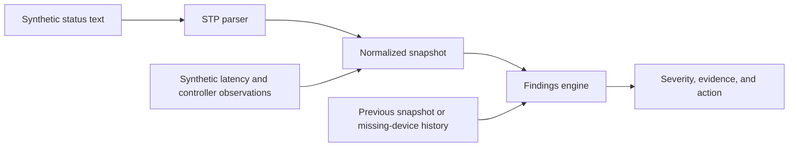

# Sonos Diagnostics — Engineering Showcase

**Turn network observations into actionable findings, with evidence for each diagnosis.**

This is a small, runnable extract of a network diagnostic tool I built after a
Sonos device won a spanning-tree root election and disrupted a LAN. It shows the
diagnostic engine and status parser using entirely synthetic incidents.

**Python standard library only. No speakers, network access, controller, or API keys required.**

```sh
python demo.py
python -m unittest discover -s tests -v
```

Run from the repository root with Python 3.10 or newer. The demonstration prints:

```text
Healthy baseline
  No findings in the supplied observations.

Speaker wins root election
  CRIT stp-root-is-sonos

Clean floor, long latency tail
  WARN tail-only-latency

Actual packet loss
  CRIT packet-loss
  WARN high-jitter
```

## What I built

The original tool combines device discovery, speaker-side status parsing,
optional controller enrichment, historical snapshots, and a diagnostic report.
This export focuses on the part a reviewer can assess without connecting to my
network: how the software turns observations into findings and avoids reporting
several symptoms as several independent problems.



## Engineering decisions worth reviewing

| Decision | Why it matters | Where to look |
|---|---|---|
| Check the STP root from the speaker's perspective | Root-election detection works without controller access | [`checks.py`](sonosdoctor/checks.py), [`stp.py`](sonosdoctor/stp.py) |
| Prefer the specific diagnosis when its prerequisites hold | A long latency tail should not also create a duplicate generic jitter alert | [`test_tail_replaces_generic_jitter`](tests/test_diagnostics.py) |
| Corroborate a restart | A boot-sequence increase can also be a topology re-announcement | [`test_boot_sequence_alone_does_not_prove_reboot`](tests/test_diagnostics.py) |
| Keep missing devices visible across snapshots | A continuing outage should not disappear from the findings after one observation | [`test_missing_device_remains_visible_without_previous_snapshot`](tests/test_diagnostics.py) |
| Separate parsing and diagnosis from collection | Incident regressions can be tested without reproducing a network failure | [`demo.py`](demo.py) |

## Scope and provenance

The findings engine, STP parser, and vendor-prefix lookup were extracted from
`secbitchris/sonos-doctor` at revision
`8762a6137c0c7fa1394e6c1cf1d1fc3583d86368`. Their executable logic is retained.
Comments containing installation-specific observations were removed; the parser's
HTTP fetch wrapper and the controller client were omitted.

The demo and its tests were written for this showcase. Device identities and
addresses are invented: `192.0.2.0/24` and locally administered `02:00:00:…` MAC
addresses. No original capture files, runtime databases, credentials, deployment
configuration, or source Git history are included.

This is an **offline engine showcase**, not the full discovery application.
It does not perform network probes or change network settings.

## Limitations

The engine expects normalized input from the original collection pipeline.
These tests cover selected incident classes, not every branch of the full
engine. Diagnostic labels are heuristics and should be checked against the
network's actual conditions. An empty findings list means no rule fired on the
supplied observations; it is not proof that a network is healthy.

The GitHub Actions workflow runs the offline tests and demo across three Python
versions. Local validation results are recorded in [VALIDATION.md](VALIDATION.md).

MIT licensed; original attribution is retained in [LICENSE](LICENSE).
